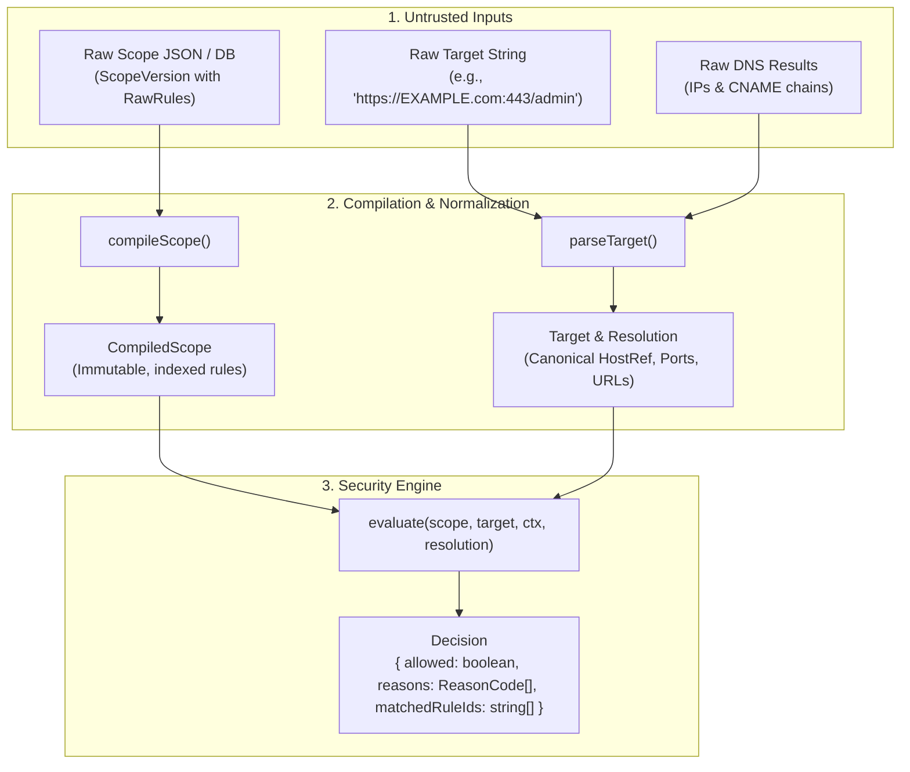

# @scope-guard/scope

A fast, deterministic, fail-closed security scope evaluation engine.

ScopeGuard evaluates whether security tools (passive recon, port scanners, intrusive active fuzzers, proxy crawlers) are authorized to interact with specific targets (domains, wildcards, IPs, CIDRs, and URL prefixes) during an engagement.

---

## Architecture & Data Flow

ScopeGuard enforces a strict separation between **untrusted raw inputs** and **immutable, normalized evaluation structures**:



---

## File & Module Guide

The package maintains a clean, flat `src/` layout where each module has a single, well-defined responsibility:

| File                                           | Role / Responsibility                                                                               | Key Exports                                                      |
| :--------------------------------------------- | :-------------------------------------------------------------------------------------------------- | :--------------------------------------------------------------- |
| [`src/index.ts`](./src/index.ts)               | Public entry point; exports the high-level API, types, schemas, and utilities.                      | `evaluate`, `compileScope`, `parseTarget`, types                 |
| [`src/types.ts`](./src/types.ts)               | Zod schemas and TypeScript types for raw rules, decisions, reason codes, and scope versions.        | `RawRule`, `ScopeVersion`, `Decision`, `ReasonCode`, `ToolClass` |
| [`src/target.ts`](./src/target.ts)             | Type definitions for normalized targets, host references, resolutions, and evaluation contexts.     | `Target`, `HostRef`, `IpHost`, `Resolution`, `EvalContext`       |
| [`src/parse-target.ts`](./src/parse-target.ts) | Boundary parser that safely converts untrusted target strings and DNS data into verified `Target`s. | `parseTarget()`, `ParseTargetResult`                             |
| [`src/compile.ts`](./src/compile.ts)           | Compiles raw rules into in-memory `CompiledRule`s with numeric bigint IPs and canonical hosts.      | `compileScope()`, `compileRule()`, `CompiledScope`               |
| [`src/match.ts`](./src/match.ts)               | Pure mathematical and string matchers for each rule type and tool/port/protocol constraints.        | `evaluateInclude()`, `evaluateExclude()`                         |
| [`src/evaluate.ts`](./src/evaluate.ts)         | Core fail-closed evaluation engine checking window, target includes/excludes, and DNS hops.         | `evaluate()`                                                     |
| [`src/normalize.ts`](./src/normalize.ts)       | RFC 1123 domain and wildcard canonicalization (IDNA punycode, lowercase, trailing dot removal).     | `normalizeDomain()`, `normalizeWildcard()`                       |
| [`src/ip.ts`](./src/ip.ts)                     | RFC-compliant IPv4, IPv6 (RFC 5952), and CIDR parser/masker with numeric `bigint` conversions.      | `parseIp()`, `normalizeIp()`, `parseCidr()`, `normalizeCidr()`   |
| [`src/url.ts`](./src/url.ts)                   | URL prefix canonicalization with default port removal, dot-segment resolution, and strict checks.   | `normalizeUrlPrefix()`                                           |
| [`src/util.ts`](./src/util.ts)                 | Shared string formatting and truncation utilities for safe, bounded error messages.                 | `show()`                                                         |

All source files have corresponding test suites in [`src/tests/`](./src/tests/).

---

## Quickstart

### 1. Compiling Scope Rules

Scope rules are defined using the `ScopeVersion` schema and compiled once into an immutable in-memory `CompiledScope`:

```typescript
import { compileScope, type ScopeVersion } from '@scope-guard/scope';

const rawScope: ScopeVersion = {
  id: 'scope-v1',
  engagementId: 'eng-100',
  notBefore: Date.UTC(2026, 0, 1),
  notAfter: Date.UTC(2026, 11, 31),
  hash: '0'.repeat(64),
  createdAt: Date.UTC(2026, 0, 1),
  rules: [
    {
      id: 'rule-apex',
      targetType: 'domain',
      effect: 'include',
      pattern: 'example.com',
      ports: [80, 443],
    },
    {
      id: 'rule-subdomains',
      targetType: 'wildcard',
      effect: 'include',
      pattern: '*.example.com',
    },
    {
      id: 'rule-internal-ip',
      targetType: 'cidr',
      effect: 'exclude',
      pattern: '192.168.1.0/24',
    },
    {
      id: 'rule-admin',
      targetType: 'url_prefix',
      effect: 'exclude',
      pattern: 'https://example.com/admin',
    },
  ],
};

const compileResult = compileScope(rawScope);
if (!compileResult.ok) {
  console.error('Failed to compile scope:', compileResult.errors);
  throw new Error('Scope invalid');
}

const compiledScope = compileResult.scope;
```

### 2. Parsing Untrusted Targets & Resolutions

Never construct `Target` objects manually. Use `parseTarget()` to safely normalize untrusted strings and DNS responses:

```typescript
import { parseTarget } from '@scope-guard/scope';

const targetResult = parseTarget('https://EXAMPLE.com:443/api/v1', {
  ips: ['203.0.113.5'],
  cnames: ['gateway.example.com.'],
});

if (!targetResult.ok) {
  console.error('Target rejected:', targetResult.message);
  // targetResult.reason === 'INVALID_TARGET'
  return;
}

const { target, resolution } = targetResult;
```

### 3. Evaluating a Security Decision

Evaluate whether a tool can access the target at a given timestamp:

```typescript
import { evaluate, type EvalContext } from '@scope-guard/scope';

const ctx: EvalContext = {
  now: Date.UTC(2026, 5, 1),
  toolClass: 'active-light', // 'passive' | 'active-light' | 'active-intrusive'
};

const decision = evaluate(compiledScope, target, ctx, resolution);

if (decision.allowed) {
  console.log('Action allowed! Matching rule IDs:', decision.matchedRuleIds);
} else {
  console.log('Action denied! Reasons:', decision.reasons);
  // e.g. ['EXCLUDED'], ['PORT_NOT_ALLOWED'], or ['RESOLVED_IP_OUT_OF_SCOPE']
}
```

---

## Security Guarantees & Evaluation Semantics

1. **Fail-Closed by Default**:
   Any missing rule, expired engagement window, unresolvable address, or unhandled protocol defaults to `allowed: false` with an explicit `ReasonCode`. There is no catch-all allow.
2. **Deterministic Hop-by-Hop DNS Verification**:
   - For hostname targets, active tools require DNS resolution (`RESOLUTION_REQUIRED`).
   - Every CNAME in the chain must independently remain in-scope (`CNAME_OUT_OF_SCOPE`).
   - Every resolved IP must be explicitly covered by an IP/CIDR include rule and must not be excluded (`RESOLVED_IP_OUT_OF_SCOPE`).
3. **Canonical RFC Normalization**:
   - **Domains**: Lowercased, stripped of trailing dots, and converted to IDNA punycode (`münchen.de` $\to$ `xn--mnchen-3ya.de`). Cyrillic/homoglyphs cannot masquerade as ASCII.
   - **IP Addresses**: Strict IPv4 and RFC 5952 IPv6 parsing into numeric `bigint`s. Shorthand (`127.1`) or hex IPs are rejected. IPv4-mapped IPv6 (`::ffff:10.0.0.1`) collapses down to IPv4.
   - **CIDRs**: Host bits must be zero (`192.168.1.1/24` is rejected; `192.168.1.0/24` is required).
   - **URL Prefixes**: Default ports (:80, :443) are stripped, dot segments are resolved, and fragments (`#`) / userinfo (`user@`) are rejected.
4. **Immutability**:
   `CompiledScope`, `CompiledRule`, `Target`, and `Resolution` objects are frozen with `Object.freeze` to prevent runtime tampering.

---

## Development & Verification

Run tests with Vitest:

```bash
npm run test -w packages/scope
```

Run TypeScript strict type checking:

```bash
npm run typecheck -w packages/scope
```
